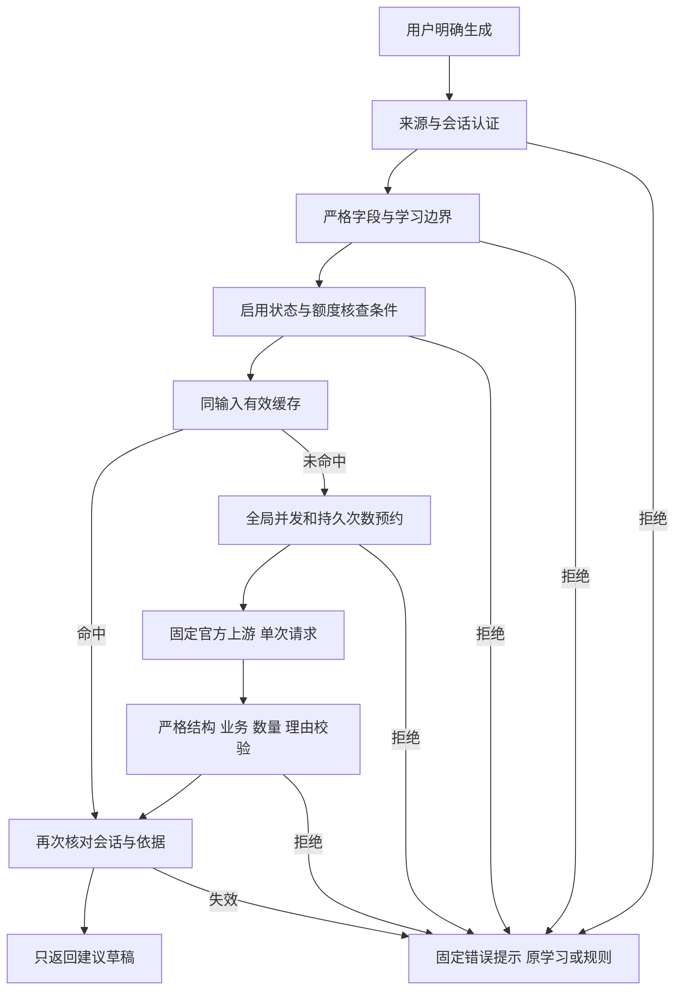

# P-03-B 服务端保护与开源架构参考：审核草稿

日期：2026-10-09。状态：**用户要求详细规划；方案未批准、未实施。** 用户已确认“限制反代”同时指防止本机服务被转成公共接口，以及不通过第三方反代访问 Qwen。本文不授权接模型、配置密钥、真实测试、改 UI、P-03-C 应用、P-05 聊天、合并或发布。

制作基线：UI 源码 `f1708417b902847d5b3949a6782b210bca4d72e6`；本机 main `b46389224716052de39e567b89a8d652a31d5b35`，schema 8。当前 UI 人工验收尚未完成。本文件只补充 Qwen 对话的功能审核材料，不改变生产预览。

后续状态补充：用户本日授权 UI 生成语义、恢复状态和接口调整，见 [UI 补充说明](2026-10-09-p03b-ui-generation-boundaries-design.md)及 [实际组件交接](../../p03b-ui-component-handoff.md)。本稿的服务端参数与真实启用仍未批准；下文“当前”代码核对取自 f170841 时点，UI 新接口以该交接为准。

## 1. 推荐方案与开源参考

推荐“在现有本机服务中增加受保护的单次建议流程”。每个请求必须按固定顺序经过检查，模型只负责提出数量与顺序，权限和次数由模型外的程序决定。

| 做法 | 取舍 |
| --- | --- |
| 现有 FastAPI/Pydantic/httpx 上实现固定检查流程（推荐） | 最贴合一次结构化建议，沿用已锁定依赖；需要按本文编写和验证规则 |
| 引入完整 Agent/护栏框架 | 适合后续多轮对话和工具；当前会增加配置、依赖及可能的额外模型调用，仍不能替代服务端鉴权 |
| 单靠提示词要求模型守规矩 | 可以作为辅助，但不能控制伪造请求、额度、网络出口或真实写入，不作为保护方案 |

参考以下开源项目的边界设计，不安装或复制整套架构：

| 项目与官方资料 | 已核实的参考点 | 本项目采用/排除 |
| --- | --- | --- |
| [NeMo Guardrails](https://github.com/NVIDIA-NeMo/Guardrails)、[护栏类型](https://docs.nvidia.com/nemo/guardrails/latest/about/rail-types.html) | 区分输入、对话、执行、输出阶段的检查 | 采用输入/输出分层；P-03-B 用固定枚举拒绝自由问题，无须额外调用主题分类模型 |
| [Pydantic AI](https://github.com/pydantic/pydantic-ai)、[输入/输出/工具检查](https://pydantic.dev/docs/ai/harness/guardrails/)、[审批边界](https://pydantic.dev/docs/ai/tools-toolsets/deferred-tools/) | 程序可阻断输入或输出；工具审批不能替代接口身份和权限校验 | 采用严格结构与阻断结果；不采用其输出重试机制，也不开放工具或客户端自报审批 |
| [LiteLLM](https://github.com/BerriAI/litellm)、[请求生命周期](https://docs.litellm.ai/docs/proxy/architecture)、[预算要求](https://docs.litellm.ai/docs/proxy/users) | 请求网关统一处理身份、模型权限、次数和预算；预算有部署/数据库条件 | 借鉴先审再发与统一计数；不部署通用代理，不开放任意模型/上游。不能照抄一个预算配置就宣称已限制费用 |

“护栏”就是放在模型前后、由程序执行的检查关卡。它不是模型自我承诺，也不是安装框架后自动具备的安全保证。具体适配为本项目设计判断，未宣称这些项目在 LinguaJet 实测过。

## 2. 当前已经有什么、还缺什么

| 代码核对 | 当前事实 |
| --- | --- |
| `backend/linguajet_local/__main__.py` | 预先绑定 `127.0.0.1:5280`，单进程，关闭访问日志；没有显式关闭代理头处理 |
| `backend/linguajet_local/app.py` | 仅 health/session/facts-check；固定 Host、Origin、浏览器来源标记；拒绝未知路由、查询及重复来源头，限制正文 |
| `backend/linguajet_local/session.py` | 启动一次性连接码5分钟，配对会话12小时；配对和事实接口有内存限频，重启不保留计数 |
| 现有鉴权 | 只有 `/facts/check` 后缀走会话认证；直接添加新模型路径会遗漏认证，必须改为明确受保护路由集合 |
| `SessionAdviceModal.jsx` | 本地规则、生成期间禁用、取消/迟到/依据失效保护；没有服务端模型限额、缓存、真实额度查询 |

不能将上述来源检查当成“只有本软件能请求”。普通程序可以自设 Origin 等头；浏览器的跨来源限制也不能替代身份认证。[OWASP 接口安全说明](https://cheatsheetseries.owasp.org/cheatsheets/REST_Security_Cheat_Sheet.html)

## 3. 允许的任务与问题边界

本轮“与软件有关”限定为 LinguaJet 的**本次学习安排**：根据已允许的学习汇总、5～60分钟、三个目标，生成新词/复习数量、顺序和可核查的理由。不是通用问答，也不是软件开发助手。

| 输入或操作 | 服务端处理 | Qwen 尝试计数 |
| --- | --- | --- |
| 有效时间 + `progress/review/lighter` + 有效真实摘要 | 可以进入后续检查 | 仅在真正获准发送前占用 |
| 新闻、写代码、生活问题、让模型忽略规则 | 没有自由输入入口；伪造正文中的 `question/messages/prompt/system/tools` 等额外字段拒绝 | 0 |
| goal 中夹带任意自然语言、编码后的指令 | 枚举不符直接拒绝，不解码后送模型 | 0 |
| 未知词书、未知上限、对账未完成、任务词书冲突 | 不请求模型；提示核对资料，保留原学习路径 | 0 |
| 本次两项上限均0 | 用本地规则说明无可安排任务，不为了展示而调用模型 | 0 |
| 模型返回工具调用、任意文本或不合规结果 | 不展示模型原文；回退规则，保留已占用次数 | 1 |

不额外花一次模型调用去判断问题是否相关。词书名按服务端受信目录由 id 映射，不能把客户端自造 label 当成指令送出；错误/缺失标记也只使用已定义枚举。服务端校验关系和一致性，不能凭摘要 hash 证明用户实际学习过，浏览器仍是学习记录来源。

自由学习问答属于 P-05，届时才另审主题白名单、对话长度和工具权限。即使是四级相关写作/翻译，也不借当前建议接口扩展功能。

## 4. 入站保护：限制本机服务被反代开放

“入站”指别人向本机服务发请求。拟定规则：

1. 保持固定 IPv4 本机回环地址 `127.0.0.1:5280`，不支持 `0.0.0.0`、局域网、公网绑定、隧道或启动时任意 host 参数。继续端口独占与单实例；服务重启产生新会话。
2. 显式 `proxy_headers=False`，不以转发头恢复所谓真实地址；检查实际连接对端为回环地址。拒绝 `Forwarded`、`X-Forwarded-*`、`X-Real-IP` 代理标记。此拒绝只是加固，代理可去掉这些头，不能据此证明无反代。[Uvicorn 设置](https://www.uvicorn.org/settings/)
3. 保留精确 Host/Origin/方法/路径白名单，不用通配符。预检只允许既有必要头；正常业务必须再鉴权。health 只返回最小服务标识，不含配置/模型/额度。status 和 draft 两个新接口都必须认证。
4. 会话凭据只在内存，使用请求 Authorization 头，不放 URL、浏览器磁盘或日志。连接码仍短时一次性；会话失效即拒绝。网页不能凭 `approved=true`、按钮名称或客户端来源自报授权。
5. 请求数限制同时覆盖新模型路由；认证失败、超大/超慢正文也有廉价拒绝策略。正文流最多256 KiB、接收总等待拟5秒，拒绝压缩正文和重复/非法 JSON 字段，先通过检查再分配模型操作。
6. 所有调用额度按本机安装的持久计数统一执行，不依赖客户端 IP、页面、requestId 或重配会话。禁止网页调整限额、清计数、改上游或启用付费模式。
7. 官方允许 Origin 不为本地 UI 预览而放宽。自动检查使用模拟正式来源；真实网页联调需要对应来源的可审查版本与另行发布授权。

保护边界：能够阻止未配对外部请求，减少误开放和额度滥用；**不能完全阻止有本机执行权限、有效会话或管理员权限的人搭建透明反代**。来源头、前端按钮、签名散列都不能证明点击来自真人。若以后要求公网多用户使用，需另审账号/权限/公网限流架构，不复用单机连接码当公网认证。

## 5. 出站保护：不借第三方反代访问模型

“出站”指本机服务向模型供应商发请求。拟定规则：

- 供应商、北京地域固定模型 `qwen3.7-flash-2026-07-15` 维持已确认决定；不静默换模型。地址是服务端审核过的官方北京 HTTPS 域名与固定路径；如业务空间需要专属官方域名，由 B 对话核对并审核，不接受网页提供的 URL。
- 私密配置严格白名单，不允许任意 `base_url/proxy/headers` 或客户端自带供应商密钥。固定路径、端口和证书校验；不跟随重定向，不支持任意兼容接口或转发 OpenAI 风格的通用聊天请求。
- httpx 显式 `trust_env=False`、`follow_redirects=False`、`verify=True`；不自动使用 `HTTP_PROXY/HTTPS_PROXY/ALL_PROXY` 环境配置，不提供网页代理设置。[HTTPX 环境变量](https://www.python-httpx.org/environment_variables/)、[请求选项](https://www.python-httpx.org/api/)
- 对官方域名解析到回环/私有/链路本地地址的情况拒绝；若实现地址检查，必须绑定实际连接目的地，不能“先检查一次 DNS、再另行解析连接”却声称消除了地址变化风险。动态官方域名采用受审核域名和证书，不随意固定过时 IP。[OWASP 请求目的地保护](https://cheatsheetseries.owasp.org/cheatsheets/Server_Side_Request_Forgery_Prevention_Cheat_Sheet.html)
- 密钥仅当前用户的仓库外配置；服务只报告是否配置，不回传内容、前后缀或原异常。配置/计数文件权限限定当前用户及必要系统主体；不声称抵抗本机管理员读取。
- 不提供供应商原始返回透传、任意网络工具、搜索、文件读取、命令执行或模型调度工具。模型返回网址也不能触发新请求。

不能可靠检测操作系统或网络层的所有透明代理；本方案保证应用不主动选第三方上游、不接受动态地址或关闭证书检查，不承诺侦测全部网络中间设备。

## 6. 哪些点击允许调用、怎样防反复消耗

首次明确显示“生成 AI 建议”，有模型结果后显示“重新生成 AI 建议”；语义已纳入 UI 补充。B 负责注入实际提供者与受保护服务状态，并保持这些操作边界。

| 用户动作 | 未来模型行为 |
| --- | --- |
| 打开软件/邀请/建议、刷新、改时间或目标、查看依据、微调 | 不自动调用；输入变化只令旧草稿失效 |
| 保存普通设置或按原设置开始学习 | 不调用；原学习逻辑保持 |
| 显式生成/重新生成 | 前端请求本机服务；是否发到 Qwen 由服务端全套规则决定 |
| 连点同一输入、跨标签页同一输入 | 同会话/相同有效依据复用成功缓存；进行中返回忙碌，不排队 |
| 不断改时间/目标、换请求编号、刷新或重配 | 仍受全局并发、每分钟/每天/阶段总尝试约束 |
| 取消/超时后立即重发 | 不释放未知上游消耗；至少等原等待窗口结束，仍计尝试与限额 |

采用/确认不是模型调用按钮；P-03-C 的真实写入仍未开放。

以下**全部是拟议参数**，沿用较早提案并明确边界，未经用户审核不能当已实施或批准：

| 保护 | 拟议值与准确含义 |
| --- | --- |
| 并发 | 全局1个上游操作；不同输入也不排队，不能按会话各开1个 |
| 成功缓存 | 300秒，最多20条，内存；会话、日期、依据、意图、模型、策略版本均一致才命中；再次鉴权并重新核对上下限 |
| 请求编号 | 同编号+同正文只处理一次；同编号+不同正文返回冲突；拒绝记录至少覆盖缓存/等待窗口，不靠此替代全局限额 |
| 上游限频 | 每滚动60秒最多2次预约尝试；缓存命中和本地拒绝不算上游，但仍受普通接口限频 |
| 日上限 | 每日最多20次预约尝试，日界为服务器 Asia/Shanghai，客户端日期不能控制额度日界 |
| 阶段上限 | P-03-B 验收总共100次预约尝试；初次真实批次另审、最多5次。不是当前授权的调用数 |
| 输入/输出 | 上游正文24 KiB以内；输出最多1024 Token（计费文字单位），原始响应64 KiB以内；字节限制不是准确 Token 计数 |
| 等待 | 服务端总30秒含读响应体、连接最多5秒；网页总35秒含解析；未知完成状态保守保留到原窗口结束 |
| 重试 | 自动重试、模型修复再问、自动路由切模型均0次；手动重试重新走检查，失败后的额度核查先完成 |

缓存键由服务端对实际验证后的摘要内容计算，不只相信客户端自报 factsToken；包含完整依据绑定与本次意图，排除每次新建的 requestId/generatedAt，避免无意义地让缓存永远不命中。缓存命中响应重新绑定这次请求编号，客户端照常检查当前依据，不把旧请求编号当新请求成功。

次数用既有提案的 Python 标准库 SQLite 文件保存，不增加完整学习数据库。发送前以事务原子预约，全局限额检查和占位一起完成；两个并发请求不能都读“剩1次”后各发送。失败/无效结果/取消/用量未取得都保留预约，崩溃后未完成预约按未知处理，不退款。重启/重新配对/换标签页不清零。第二个服务实例不能共用计数绕过锁；损坏、写入失败或时间回退异常时禁用模型，不把无法读取当0消费。

## 7. 固定检查流程与状态

后端拟用明确状态：disabled（未启用）、ready（符合前置条件）、running（等待）、awaiting-quota-check（失败后待核查）、quota-unavailable（耗尽/过期）、limit-reached（次数达限）、blocked（配置/计数/边界异常）。网页不能用一次状态查询自行解除停用。成功草稿不改状态为“计划已应用”。

输出严格限定数量、顺序、理由代码及事实引用；程序重算时间和上限，理由由程序从已核验事实生成。模型不得生成自由答复、超出摘要的掌握率或虚构词项。未知键、重复键、真假值冒充整数、截断、任意工具调用、非法引用均拒绝；不截取/修补模型 JSON 后冒充成功。输入分离和提示词是辅助手段，权限/输出检查必须在模型外。[OWASP 模型输入与输出保护](https://cheatsheetseries.owasp.org/cheatsheets/LLM_Prompt_Injection_Prevention_Cheat_Sheet.html)

## 8. 额度、失败、紧急停用与隐私

- 已确认测试付费预算0元，只使用固定模型免费额度。保护依赖供应商“用完即停”及当前额度核查，本机调用计数不能证明不会扣款，也不是账号共享余额。
- 模型默认关闭。每批真实测试之前核查额度、有效期、保护状态；失败后暂停后续真实调用直到核查并明确恢复。只做配对、查本机状态或看规则无需模型启用。
- 不接受前端 `freeQuotaVerified=true` 或自报余额当作保护证据。恢复由用户在受控本机操作中确认；当前没有已经核验可用的自动余额客户端。本方案不新增控制台私有接口，不收集控制台会话。
- 已有具体耗尽证据、确认过期、普通鉴权失败、供应商限频、断网、超时分开提示；未知显示“暂时无法确认剩余额度”，不填0。精确供应商错误映射由 B 按实施时官方资料验证。
- 任意失败都不改学习记录；规则也无法计算则诚实显示数据不足。关闭模型仍可按原学习路径学习。
- 用户可通过本机停止服务立即阻止新模型请求；已发供应商请求可能仍消耗，不能承诺取消退款。疑似密钥泄露时由用户在官方控制台撤销/轮换，不从网页自动执行。
- 计数只保存预约时间、阶段、结果码、固定模型和可用 usage；不落提示词、学习摘要、模型原文、会话凭据、密钥或绑定 hash。内存缓存过期/停用/会话失效即清理；明细拟保留30天，累计数不能随清理清零。诊断保持白名单和最近20条，不转储上游异常全文。

## 9. 接入落点与自动验收门槛

这是文件职责提案，不是可直接执行的已批准编码计划：

| 位置 | B 对话需要交付的行为 |
| --- | --- |
| `app.py / __main__.py / session.py` | 明确鉴权路由集合、关闭代理头、实际对端和方法/来源/正文/等待边界，保留现有接口 |
| 新 advice contracts/policy 模块 | 时间5～60、三目标枚举、发送白名单、服务端目录、数量/时间/理由规则；默认拒绝未知动作 |
| 新 advice service/usage 模块 | 固定检查顺序、缓存/单并发/原子预约、重启不清次数、断开/超时未知状态 |
| 新 provider/config 模块 | 私密配置、固定官方上游、禁止环境代理/重定向、总等待、严格解析、0自动重试 |
| `src/data/assistant` 的新 advice 客户端及 React 适配 | 复用现有 buildFactsRequest/isFactsRequestCurrent，接 SessionAdviceModal.generate；当前传入的五项 settings 不是完整 Facts v1，不能直接假装就是后端请求 |
| UI/维护诊断 | 按批准方案补明确模型生成入口、剩余次数/等待提示、失败后核查状态；保留草稿不应用和原设置入口 |

先以合成摘要、假供应商和计数 spy 自动验证；不以真实免费额度做压力测试：

| 必测场景 | 必须观察到的结果 |
| --- | --- |
| 无会话、错/重复来源头、新status未认证、带代理头 | 拒绝；上游0次；无学习写入 |
| 自由问题、prompt/messages/tools、自然语言goal、伪造目录label | 拒绝或按规范目录处理；任意指令不进入上游 |
| 成功后同输入连点100次、双标签页 | 有效缓存内上游共1次；普通接口过频可429，不变成100次调用 |
| 同时100个不同输入 | 全局最多1个上游；其余忙碌/限流；不排队后继续消费 |
| 换编号/输入、重配、刷新、重启 | 仍受2/分钟、20/日、100/阶段及持久计数约束 |
| 剩余次数1时两个并发预约 | 最多一个成功占位；另一拒绝 |
| 取消/超时/崩溃/缺usage | 预约不回退，等待/未知状态明确，不自动补发 |
| 启动存在HTTPS_PROXY、恶意base_url、302重定向、私有目的地址 | 不走环境代理；动态/转跳目的地不收到密钥 |
| 模型返回工具/自由文本/越界数/非法理由/重复键/截断 | 模型结果不展示为成功；规则回退；尝试保留 |
| 计数库损坏/写失败、额度未核查/耗尽/过期 | 模型关闭；普通学习与规则仍可用 |
| 返回前改日期/书/记录/会话过期 | 不作为当前草稿展示，不自动生成下一份 |
| 全流程前后记录/日志检查 | 正式学习 storage 完全不变；日志与复制诊断无密钥/摘要/原响应 |

完成模拟验证、相关回归与源码审查后，才提交具体真实小批样本和额度核查步骤，取得对应启用。没有账号化公网服务、全量 Agent 框架、自动充值/切模型、主题审查二次模型、独立新数据库或 P-03-C 写入。

## 10. 审核顺序

用户已确认两种反代方向。本草稿先审核“采用固定学习任务与模型外检查，不引入整套 Agent”这一架构选择；之后分别审核网络/鉴权规则、调用参数、异常/额度与验收。一次一个问题，不把某次回复“1”解释成全部规则或真实测试批准。

批准后，由 Qwen 对话基于已认可的 UI 提交和本草稿形成完整实施计划，再实施。当前只新增本文件，不改代码/依赖/用户记录、不执行产品测试或模型调用，不写 Obsidian。
